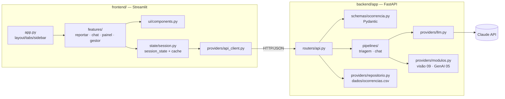

# 04 · Front-End em Sistemas de IA — CitizenTech Zeladoria Acessível

POC da GS 2026.2. É a **interface única** da Plataforma CitizenTech. Com ela, o cidadão
**reporta** um problema urbano (texto e foto), a **IA tria** o relato (tipo, urgência e
orientação), o cidadão **confere e confirma** (human-in-the-loop) e recebe um **protocolo**.
O mesmo app tem um **assistente de dúvidas**, um **painel da cidade** com Plotly e uma
**fila do gestor**, que muda o status dos chamados.

> Front em **Streamlit** e back-end em **FastAPI**. Os dois são serviços separados e
> conversam por HTTP. O LLM só é chamado no back-end, e a resposta sai num modelo Pydantic.

---

## 1. Problema e público

- **Quem é afetado:** moradores que encontram buracos, rachaduras e outros problemas na via.
  Também quem tem dificuldade com os canais atuais, que dependem muito de telefone e
  formulários longos. Isso inclui **pessoas surdas ou com deficiência auditiva** e idosos.
- **A dor concreta:** reportar é lento, o cidadão não sabe a quem recorrer e não recebe retorno.
  A prefeitura recebe relatos sem prioridade definida, e casos de risco a pessoas se perdem
  na fila.
- **Fontes:** o IBGE (Censo 2010) registrou cerca de 9,7 milhões de brasileiros com algum
  grau de deficiência auditiva. Pela Lei 13.146/2015 (LBI), serviços públicos precisam ser
  acessíveis. Os canais 156 das capitais recebem milhares de pedidos de tapa-buraco por mês;
  veja os dados abertos de SAC/156 da Prefeitura de SP.
  *(Coloque aqui o link exato que o grupo consultou e o relato/entrevista colhido.)*

## 2. ODS

| ODS | Como a solução contribui |
|---|---|
| **ODS 11 — Cidades e comunidades sustentáveis** (meta 11.2/11.7) | Acelera a manutenção de vias e calçadas e põe primeiro os casos de risco, com dados abertos no painel. |
| **ODS 10 — Redução das desigualdades** (meta 10.2) | O canal funciona só por texto e com alertas visuais. Tem alto contraste, linguagem simples e não exige ligação, o que inclui pessoas surdas, idosas e com baixa visão. |

## 3. Fluxo CitizenTech (entrada → IA → ação)

```
Cidadão ──(texto + foto opcional, validados)──▶ Streamlit
   │                                                │ HTTP (providers/api_client.py)
   │                                                ▼
   │                                       FastAPI /visao  → módulo 09 (ou stub)
   │                                       FastAPI /triagem → LLM → Triagem (Pydantic)
   │                                                │      (falhou? → regras, avisando)
   ◀── selo de urgência + orientação + confiança ───┘
   │
   └─(confirma ou CORRIGE tipo/urgência)──▶ POST /ocorrencias → protocolo OC-XXXX
                                                     │
                       painel Plotly + fila do gestor (PATCH status) ◀┘
```

## 4. Arquitetura



| Camada | Pasta | Responsabilidade |
|---|---|---|
| Telas | `frontend/features/` | Uma tela por responsabilidade: `reportar`, `chat`, `painel`, `gestor` |
| Componentes | `frontend/ui/components.py` | `selo_prioridade`, `cartao_ocorrencia`, `barra_confianca`, `estado_vazio`, `kpi`… |
| Estado | `frontend/state/session.py` | Chaves do `st.session_state`, `@st.cache_data` e `@st.cache_resource` |
| Cliente HTTP | `frontend/providers/api_client.py` | Único ponto que chama a API e traduz falhas em mensagens simples |
| Endpoints | `backend/app/routers/` | `/health`, `/triagem`, `/ocorrencias` (GET/POST/PATCH), `/visao`, `/chat`, `/feedback` |
| Contratos | `backend/app/schemas/` | Pydantic, igual ao contrato de dados de `CONTEXTO.md` |
| IA | `backend/app/pipelines/` | Prompt, validação da saída e fallback |
| Acesso externo | `backend/app/providers/` | LLM, dados (CSV) e módulos das outras disciplinas |

### Integração com os outros módulos

| Módulo | Como entra | Situação atual |
|---|---|---|
| `09-visao-computacional` | `providers/modulos.py` importa `inferencia.detectar(bytes) -> {"tipo","confianca"}` | **Stub** (heurística de brilho/contraste) até o módulo expor essa função |
| `05-generative-ai` | `providers/modulos.py` importa `assistente.responder(msg, historico) -> str` | **Stub** (LLM direto ou FAQ por regras) |
| `dados/ocorrencias.csv` | `RepositorioCSV` lê a base compartilhada (somente leitura) e grava as novas em `.runtime/` | Real |
| `01-rpa-ia` | Lê o mesmo CSV/contrato. As ocorrências criadas aqui saem no `GET /ocorrencias` | Contrato pronto |
| `07-iot-ouviai` | `origem="iot"` e `tipo="alerta_sonoro"` já aparecem no painel e nos filtros | Contrato pronto |

Para trocar um stub pelo módulo real, basta criar o arquivo com a função indicada na pasta
da disciplina. O front não muda.

## 5. Requisitos técnicos: onde estão

| Requisito | Onde |
|---|---|
| Validação antes do envio | `features/reportar.py::_validar` (front) e `RelatoEntrada` com `min/max_length` (back). Foto: tipo e tamanho checados no front e na API (`415/413/422`) |
| LLM só no back e saída estruturada | `pipelines/triagem.py` → `Triagem` (Pydantic). Resposta fora do schema → fallback |
| Resposta útil, não dump | Selo de urgência, resumo, "o que fazer agora", órgão responsável, barra de confiança e protocolo |
| `session_state` | `state/session.py::PADROES`: perfil, triagem pendente, meus protocolos, chat, feedbacks |
| `cache_data` / `cache_resource` | `ocorrencias_df()` (ttl 60 s; filtros não chamam a API de novo), `saude_api()`, `cliente()` (uma sessão HTTP por processo). Depois de criar ou atualizar, `invalidar_ocorrencias()` |
| Histórico no estado alimentando a UI | "Meus protocolos", histórico do chat e painel/KPIs que se atualizam após confirmar |
| Falhas | `ClienteAPI._req`: API fora do ar, timeout, 4xx/5xx e JSON inválido viram `ErroAPI` com texto simples. O back tem handler global que não vaza stack trace, e `showErrorDetails=false` |
| Segredos | `ANTHROPIC_API_KEY` só por variável de ambiente ou `.env`. Existe `.env.example`, e o `.gitignore` cobre `.env` e `secrets.toml` |
| CORS | `main.py`: lista vinda de `CORS_ORIGINS`, ignora `*` e libera só GET/POST/PATCH e `Content-Type` (testado) |
| Dados pessoais | O formulário não pede nome, CPF nem telefone, e a sidebar avisa para não informar. A localização é só por bairro |
| Prompt injection | O relato vai entre `<relato>` com instrução para ignorar comandos dentro dele, e a saída é validada pelo schema |

## 6. UX e acessibilidade (cuidados aplicados)

- **Cor nunca sozinha:** urgência = cor + ícone (⛔ ⚠️ ✅) + texto ("Prioridade ALTA — risco
  a pessoas"). No gráfico de barras, cada urgência também tem uma **hachura** diferente.
- **Contraste:** as cores dos selos (#B42318, #B54708, #067647) têm contraste ≥ 4,5:1 com o
  texto branco (WCAG AA). Também há um **modo alto contraste** (preto/amarelo) na sidebar.
- **Rótulos** claros em todos os campos ("(obrigatório)"), `help` com exemplo e
  `aria-label` nos selos.
- **Foco visível** (contorno de 3 px) e botões com altura ≥ 44 px. Fonte base de 17 px.
- **Latência:** `st.status` com etapas ("Olhando a foto…", "Entendendo a descrição…"),
  `st.spinner` no chat e no envio e `st.toast` na confirmação.
- **Estados vazios e de erro** com componentes próprios e botão "Tentar de novo".
- **Transparência da IA:** a barra de confiança diz se a confiança é alta, moderada ou baixa
  e alerta quando passa de < 50 %. Se o LLM falhar, o aviso diz "modo simplificado". O
  status do serviço aparece na sidebar (🟢/🟡/🔴, sempre com texto).
- **Linguagem simples** e nenhum jargão técnico na tela.
- **Human-in-the-loop (3 pontos):** (1) o cidadão confirma ou **corrige** tipo e urgência
  antes do envio, e a correção vira feedback registrado; (2) 👍/👎 em cada resposta do
  assistente; (3) o gestor decide o avanço do status.

### Visualização e componentização

- Plotly: **mapa** (`scatter_map`, hover e zoom) e **linha do tempo** por dia/urgência, além
  da tabela com barra de confiança.
- **3 filtros** (urgência, tipo, situação) que mudam KPIs, mapa, gráfico e tabela.
- Componentes reutilizados: `cartao_ocorrencia` (meus protocolos e fila do gestor),
  `selo_prioridade` (revisão e cartões, com `compacto=True/False`), `painel.filtros(df, chave)`
  (painel e gestor) e `estado_vazio` (4 telas).

## 7. Como rodar

### Local
```bash
cd 04-frontend
pip install -r requirements-dev.txt
cp .env.example .env            # opcional: coloque ANTHROPIC_API_KEY
cd backend && uvicorn app.main:app --port 8000      # terminal 1
cd frontend && streamlit run app.py                 # terminal 2 → http://localhost:8501
```
Sem chave de API tudo funciona em **modo simplificado** (triagem por regras), o que é útil
para avaliar sem custo.

### Docker (Opção B)
```bash
cd 04-frontend
cp .env.example .env
docker compose up --build       # web: http://localhost:8501 · API: http://localhost:8000/docs
```
O compose monta `../dados/ocorrencias.csv` como somente leitura e guarda as ocorrências
novas num volume. Os containers rodam com usuário não-root.

### Plataforma (Opção A, opcional)
API no Render (`backend/`, start `uvicorn app.main:app --host 0.0.0.0 --port $PORT`, com env
`ANTHROPIC_API_KEY` e `CORS_ORIGINS=https://<app>.streamlit.app`). Front no Streamlit Cloud
(`frontend/app.py`, com `API_URL` em *Secrets*, conforme `frontend/.streamlit/secrets.toml.example`).

### Testes automatizados
```bash
cd 04-frontend && python -m pytest -q     # 13 testes, sem subir a interface
```

## 8. Decisões técnicas

- **Streamlit, não Gradio:** o app tem várias telas (cidadão, painel e gestor), dashboard com
  filtros e um fluxo em duas etapas (analisar → confirmar). `tabs`, `form`, `status` e o
  `session_state` do Streamlit expressam isso com menos código. Gradio se sai melhor em
  demos de uma única função.
- **Prompt e saída:** o prompt de sistema curto define o critério de "alta" (risco a pessoas),
  proíbe inventar telefones e prazos e isola o relato do cidadão em `<relato>`. A saída é
  **JSON validado por Pydantic** (`Triagem`) para a UI poder montar selo, orientação e
  protocolo, e para recusar respostas fora do contrato. Modelo padrão: `claude-haiku-5-5`
  (barato e rápido para classificação), configurável por `LLM_MODEL`.
- **Fallback por regras:** se o LLM falhar, o cidadão ainda consegue registrar o problema, e a
  tela avisa que a análise é simplificada.
- **Deploy em Docker:** sobe front e API juntos com um único comando, igual em qualquer
  máquina, sem depender de conta em plataforma.

## 9. Ética e limites da IA

| Risco | Mitigação |
|---|---|
| **Erro de classificação** (ex.: risco real marcado como "baixa") | Revisão obrigatória pelo cidadão antes do envio, barra de confiança, alerta quando a confiança passa de < 50 % e decisão final do gestor |
| **Viés** (bairros periféricos descritos com outras palavras recebem prioridade menor) | A prioridade usa o critério "risco a pessoas", não o bairro. O painel permite auditar a distribuição por bairro e urgência. As correções humanas ficam em `feedback.csv` para revisão |
| **Alucinação** (telefones, prazos ou leis inventados) | O prompt proíbe isso, a saída tem campos limitados (`max_length`) e o chat tem aviso "pode conter erros" |
| **Uso indevido** (dados pessoais, trote, prompt injection) | O app não pede dados pessoais e avisa contra eles, a entrada tem limite de tamanho, o relato fica delimitado no prompt e a saída é validada |

**O que a solução NÃO faz:** não substitui 190/193 em emergências, não garante prazo de
atendimento, não identifica pessoas em fotos e não decide sozinha. Todo chamado passa por um
humano.

## 10. Evidências de validação

### (b) Casos de teste da IA

Executados com `pytest` (`tests/test_api.py::CASOS`) no **modo regras**, a configuração
padrão sem chave. Com chave de API, repita os mesmos casos e anote a saída do LLM.

| # | Entrada | Esperado | Obtido (1ª versão) | Ajuste realizado |
|---|---|---|---|---|
| 1 | "Buraco enorme na avenida, uma moto caiu agora há pouco" | buraco / alta | buraco / alta | — |
| 2 | "Rachadura no muro da escola, parece que vai cair perto das crianças" | fissura / alta | fissura / **media** | A palavra "crianças" não casava por causa do acento: entrou a normalização sem acentos (`normalizar`) → **alta** |
| 3 | "Tem uma trinca pequena na calçada da praça" | fissura / baixa | fissura / baixa | — |
| 4 | "Lâmpada do poste da minha rua está queimada" | outro / baixa | **buraco** / media | "rua" estava na lista de palavras de buraco. A lista foi trocada por termos específicos ("buraco", "cratera", "asfalto", "afund") → **outro/baixa** |
| 5 | LLM devolve `{"tipo":"dragão"}` (fora do schema) | Não quebra; cai em regras | `fonte="regras"` | Fallback por `ValidationError` |
| 6 | LLM com timeout | Não quebra; aviso de modo simplificado | `fonte="regras"` | Captura de `ErroLLM` |
| 7 | API desligada (porta fechada) | Mensagem simples, sem traceback | "Não conseguimos falar com o serviço agora…" | `ClienteAPI` traduz `ConnectionError` |

### (a) Teste com pessoas do público-alvo — *a preencher pelo grupo*

> ⚠️ Esta seção **precisa ser preenchida com testes reais**. Não invente dados.

**Roteiro (≈5 min por pessoa):**
1. "Você viu um buraco perto de casa. Use o app para avisar a prefeitura." (observar sem ajudar)
2. "A IA acertou? Mude a urgência se discordar e envie."
3. "Pergunte ao assistente como acompanhar o protocolo."
4. "No painel, mostre só os casos de alta urgência."
5. De 1 a 5, quão fácil foi? O que confundiu?

| Pessoa (perfil, sem nome) | Concluiu tarefas 1–4? | Nota (1–5) | Observações |
|---|---|---|---|
| P1 — ex.: idoso(a), 6x anos | | | |
| P2 — ex.: pessoa surda / com baixa audição | | | |
| P3 — ex.: morador(a) da periferia, usa só celular | | | |

**Ajuste feito a partir do feedback:** *(descrever, por exemplo: "P1 não percebeu que podia
corrigir a urgência → incluímos o texto 'Está certo? Você pode corrigir antes de enviar.'")*

### Evidência de execução
- `pytest`: 13 testes passando (triagem, fallback do LLM, fluxo de ponta a ponta, validação,
  visão/foto, chat, CORS e cliente com API fora do ar).
- Teste manual no navegador: relato → triagem "Prioridade ALTA" → confirmação → protocolo
  → painel atualizado (3 ocorrências, 2 de alta). *(Adicione os prints em `docs/`.)*
