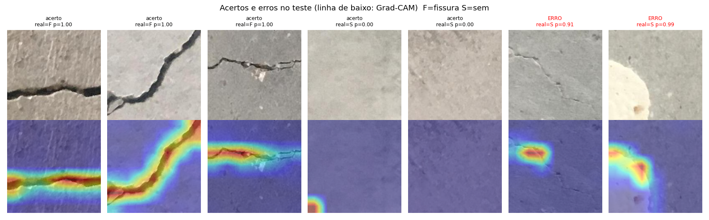
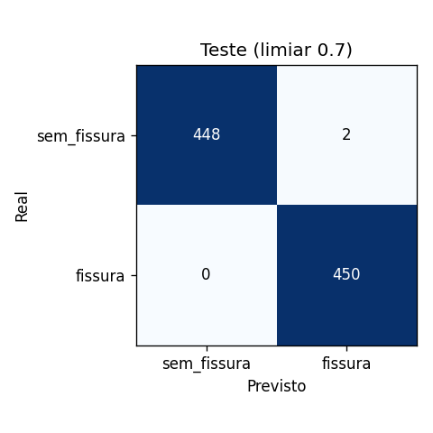
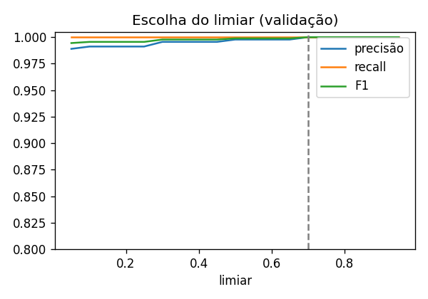
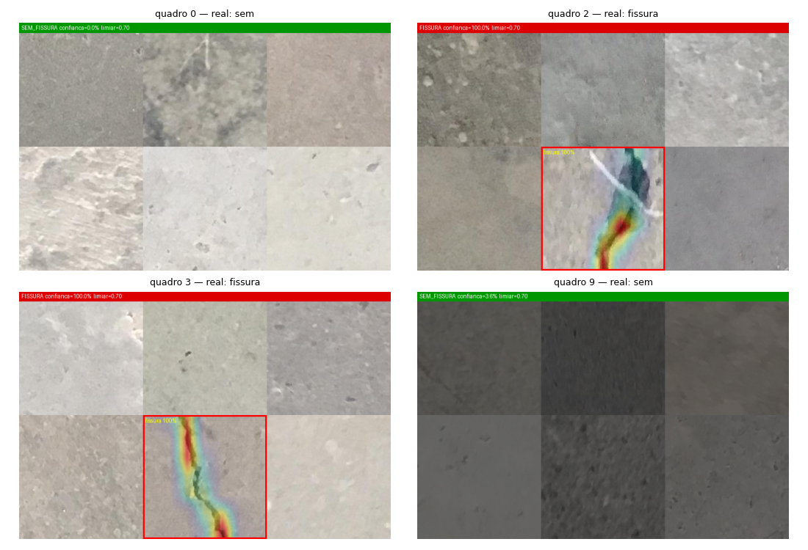

# 09 — Visão Computacional: detecção de fissuras em concreto

Módulo da **Plataforma CitizenTech de Zeladoria Urbana Acessível** (ODS 11, ODS 9, ODS 10).
O cidadão envia uma foto de uma calçada, muro ou estrutura. O módulo classifica a imagem como
**fissura / sem fissura**, mostra **onde** está a fissura (caixas e mapa de calor Grad-CAM) e
a **confiança** do modelo. Quando há fissura, ele gera uma **Ocorrência** no contrato comum
(`origem: "visao"`, `tipo: "fissura"`).

> ⚠️ O módulo apoia a **triagem** de locais para inspeção. A presença de uma fissura na imagem
> não determina a gravidade nem a segurança estrutural. Essa avaliação exige vistoria técnica.

## Resumo dos resultados (conjunto de teste: 900 recortes nunca vistos no treino)

| Métrica | Valor (limiar 0,70) |
|---|---|
| Precisão (fissura) | **0,9956** |
| Recall (fissura) | **1,0000** |
| F1 | **0,9978** |
| Acurácia | 0,9978 · ROC-AUC 1,000 |
| Matriz de confusão `[[VN, FP],[FN, VP]]` | `[[448, 2], [0, 450]]` |
| Latência por foto 681×454 (6 janelas, CPU) | **33 ms → 30 FPS** sem Grad-CAM · 72 ms → 13,8 FPS com Grad-CAM |
| Latência por recorte 227×227 | 10,7 ms → 94 FPS |
| Ronda em vídeo (20 quadros, com Grad-CAM e gravação) | 71,6 ms/quadro · 13,2 FPS · 100% de acerto por quadro |

Equipamento: CPU Intel64 Family 6 Model 158 (Coffee Lake, 6 threads), Windows 10,
PyTorch 2.15 CPU. Nenhuma GPU foi usada. O treino levou cerca de 3 min (3 épocas, 4.200 imagens).
Os arquivos de origem estão em `resultados/metricas.json` e `resultados/desempenho.json`.

## Estrutura

| Arquivo | Etapa do enunciado |
|---|---|
| `preparar_dados.py` | 1. Seleção, amostragem e split treino/validação/teste sem vazamento |
| `treinar.py` | 2 e 3. Transfer learning, escolha do limiar, métricas, matriz de confusão e análise de acertos e erros |
| `visao.py` | 4. **API para o front-end**: `analisar_imagem()` e `processar_sequencia()` |
| `demo_monitoramento.py` | 4 e 5. Ronda em vídeo e benchmark de latência e FPS |
| `modelo/` | Pesos ajustados (6 MB) e `config.json` com o limiar |
| `resultados/` | Figuras, métricas, vídeos (`ronda_original.mp4`, `ronda_anotada.mp4`) e ocorrências geradas |

## Como rodar

```bash
pip install -r requirements.txt
```

Para usar o modelo já treinado (não precisa do dataset):

```bash
python visao.py minha_foto.jpg
```

Esse comando imprime o JSON do resultado e grava `saida_anotada.jpg`.

Para reproduzir tudo, baixe o dataset (240 MB, .rar) em https://data.mendeley.com/datasets/5y9wdsg2zt/2,
extraia-o (gera as pastas `Positive/` e `Negative/`) e rode:

```bash
python preparar_dados.py --origem CAMINHO_DO_DATASET --por-classe 3000
```

```bash
python treinar.py --origem CAMINHO_DO_DATASET --epocas 3
```

```bash
python demo_monitoramento.py --origem CAMINHO_DO_DATASET
```

## Integração com o CitizenTech (front-end 04 e RPA 01)

```python
import sys; sys.path.append("09-visao-computacional")
from visao import analisar_imagem, processar_sequencia

r = analisar_imagem(foto, latitude=-23.55, longitude=-46.63, bairro="Sé")  # caminho, PIL ou numpy RGB
r["classe"], r["confianca"]      # "fissura", 0.9998
r["imagem_anotada"]              # numpy RGB → st.image(...) / gr.Image
r["ocorrencia"]                  # dict no contrato Ocorrência (None se não houver fissura) → gravar em dados/ocorrencias.csv
r["janelas"]                     # probabilidade por trecho da foto
r["latencia_ms"], r["aviso"]

m = processar_sequencia("video.mp4", saida="anotado.mp4", bairro="Sé")  # ou uma pasta/lista de .jpg
m["fps"], m["latencia_media_ms"], m["ocorrencias"]
```

Exemplo no Gradio: `gr.Interface(lambda img: (analisar_imagem(img)["imagem_anotada"], analisar_imagem(img)["ocorrencia"]), gr.Image(), [gr.Image(), gr.JSON()])`.

A ocorrência gerada segue o contrato. A **prioridade** é uma heurística de triagem: `alta` quando a confiança é ≥ 0,95 e a fissura cobre ≥ 50% das janelas, `media` quando a confiança é ≥ 0,80 e `baixa` nos demais casos. O status inicial é `aberta`. Daí em diante, o RPA (01) encaminha a ocorrência à prefeitura e a otimização de rotas (03) a coloca na fila de inspeções. Exemplos reais estão em `resultados/ocorrencias_demo.json`.

## 1. Dados e preparação

- **Base:** *Concrete Crack Images for Classification* (Özgenel, 2019, Mendeley Data v2, DOI 10.17632/5y9wdsg2zt.2, licença CC BY 4.0). São 40.000 recortes RGB de 227×227 (20 mil com fissura e 20 mil sem), extraídos de 458 fotos de alta resolução de prédios do campus da METU. O SHA-256 do `.rar` foi conferido com o publicado na API do Mendeley.
- **Amostra** (prazo de 4 h): 3.000 recortes por classe, divididos em 70/15/15, ou seja, 4.200 para treino, 900 para validação e 900 para teste, com classes balanceadas.
- **Sem vazamento de recortes da mesma foto:** o dataset não informa a foto de origem, mas os arquivos são numerados na ordem em que foram gerados, e recortes vizinhos vêm da mesma foto. Por isso o split é feito por **blocos de 100 números consecutivos** (≈ 1 foto ≈ 87 recortes). Cada bloco inteiro vai para um único conjunto, e o script verifica com `assert` que nenhum bloco aparece em dois conjuntos. Essa é uma aproximação, e uma foto ainda pode ser dividida na fronteira entre dois blocos.
- **Pré-processamento:** redimensionamento para 224×224 (entrada da MobileNet), escala para 0..1 e normalização pela média e desvio-padrão do ImageNet, os mesmos usados no pré-treino.
- **Aumento de dados** (apenas no treino): espelhamentos, rotações de 90°, brilho entre 0,6 e 1,4 e contraste entre 0,7 e 1,3. Fissuras não têm orientação fixa, e a variação de luz simula foto de celular, sombra e entardecer.

## 2. Arquitetura e justificativa

**MobileNetV3-Small pré-treinada no ImageNet (transfer learning)**, com a cabeça trocada por uma única saída sigmoide.
Os blocos `features[0:9]` ficam congelados, porque já detectam bordas e texturas genéricas. Os blocos finais e o classificador são ajustados com AdamW (lr 1e-3) e BCE, por 3 épocas.

- **Por que classificação e não detecção?** Esta base tem rótulos por imagem, sem caixas. A localização é obtida de duas formas: (a) uma **janela deslizante** que divide a foto em trechos de ~227 px, a mesma escala do treino, e classifica cada um; (b) o **Grad-CAM**, que destaca os pixels responsáveis pela decisão. O resultado é uma caixa por trecho com fissura e um mapa de calor sobre a linha da fissura, sem precisar de anotação de caixas. Um detector como o YOLO no RDD2022 seria o próximo passo para buracos em vias (ver Limitações).
- **Por que a MobileNetV3-Small?** Ela tem 1,5 M de parâmetros e 6 MB de pesos, roda a cerca de 94 recortes/s em uma CPU comum e funciona no servidor da prefeitura ou no celular (exportável para ONNX/TFLite). Uma ResNet-50 seria cerca de 10× mais pesada, e com F1 de 0,998 há pouco espaço para ganho de qualidade. O equilíbrio entre qualidade e velocidade favorece o modelo leve.
- **Extração de características visuais:** a figura `resultados/acertos_erros.png` mostra que o Grad-CAM se concentra **sobre o traço escuro e contínuo da fissura** e ignora poros, manchas e granulação. A rede aprendeu de fato a característica "linha escura fina e alongada com bordas nítidas", e não pistas espúrias como cor ou brilho.



## 3. Avaliação

 

- **Limiar de confiança = 0,70**, escolhido **na validação** (nunca no teste). O critério foi o maior F1 com recall ≥ 0,97. Na triagem urbana, deixar de ver uma fissura (FN) custa mais do que uma inspeção extra (FP), mas inspeções desnecessárias também gastam equipe. Com o limiar de 0,50, o teste teria precisão 0,993 (3 FP). Com 0,70, a precisão sobe para 0,996 (2 FP) e o recall continua em 1,0.
- **Análise dos 2 erros (falsos positivos, `resultados/erros_teste.csv`):**
  - `Negative/06238.jpg` (p = 0,99): borda de uma mancha clara de tinta ou reboco sobre o concreto. O contorno escuro e irregular da mancha imita uma fissura. É uma **interferência de textura e obstáculo**.
  - `Negative/05575.jpg` (p = 0,91): há uma linha fina e escura visível, provavelmente uma microfissura ou risco que o anotador rotulou como "sem fissura". É um caso de **ruído de rótulo**, e para a triagem sinalizá-la é aceitável.
- **Iluminação e sombra:** na ronda, 4 dos 20 quadros foram escurecidos para 45% do brilho (simulando sombra ou baixa luz), e nenhum foi classificado errado (`quadros_exemplo.png`, quadro 9). O aumento de brilho no treino contribui para isso.
- **Cautela:** métricas próximas de 100% são esperadas e também relatadas na literatura para esta base, porque os recortes são limpos, bem enquadrados e de um único campus. Fotos reais de cidadãos (perspectiva, pichação, vegetação, juntas de dilatação, sombras duras de grades) devem ter desempenho menor. Por isso o modelo deve ser revalidado com fotos coletadas na plataforma e usado só como triagem.

## 4. Demonstração integrada (vídeo e sequência)

`demo_monitoramento.py` monta uma ronda de 20 quadros de 681×454 (mosaicos 3×2 de recortes do **teste**, com 0 a 3 trechos com fissura cada, alguns escurecidos), grava `ronda_original.mp4` e processa o vídeo com `processar_sequencia`. Ele gera `ronda_anotada.mp4` e abre **uma ocorrência por trecho contínuo com fissura** (5 ocorrências), o que evita duplicar chamados a cada quadro.



## 5. Desempenho (tempo real)

| Cenário (CPU, 6 threads) | Latência média | p95 | FPS |
|---|---|---|---|
| Recorte 227×227, só classificação | 10,7 ms | 11,1 ms | 93,7 |
| Foto 681×454 (6 janelas), sem Grad-CAM | 33,4 ms | 34,9 ms | 30,0 |
| Foto 681×454, com Grad-CAM nas janelas positivas | 72,5 ms | 83,9 ms | 13,8 |
| Lote de 32 recortes | 181 ms | — | 176 recortes/s |
| Ronda em vídeo (análise, desenho e gravação) | 71,6 ms | — | 13,2 |

O custo cresce com o número de janelas (fotos são reduzidas para no máximo 908 px, ou seja, até 4×4 janelas) e com o Grad-CAM, que exige um *backward* por janela positiva. Para monitoramento contínuo em tempo real, o caminho é desligar o Grad-CAM (`explicar=False`), atingindo **30 FPS em CPU**, e gerar o mapa de calor apenas nos quadros que abrem uma ocorrência. No upload de uma foto pelo cidadão, 70 ms é imperceptível.

> Na linha "recorte 227×227 com Grad-CAM" do `desempenho.json`, o recorte usado não tinha fissura, então o Grad-CAM não foi acionado e a latência ficou igual à da classificação pura. O custo real do Grad-CAM aparece na linha da foto 681×454.

## Limitações e próximos passos
- O modelo só cobre fissuras em concreto. **Buracos e danos no asfalto** exigiriam um detector (YOLOv8n) treinado no RDD2022.
- O split por blocos aproxima, mas não garante, a separação por foto original.
- Imagens de pessoas e placas de veículos podem aparecer nas fotos dos cidadãos. A plataforma deve aplicar desfoque e minimização de dados (LGPD), conforme o módulo 06-governança.
